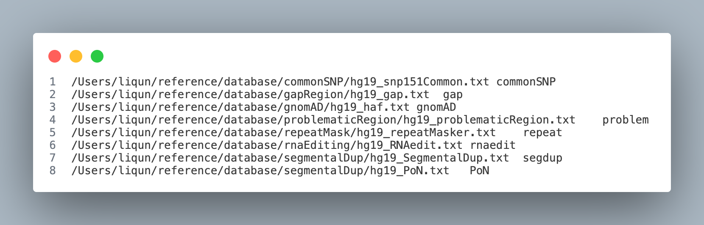
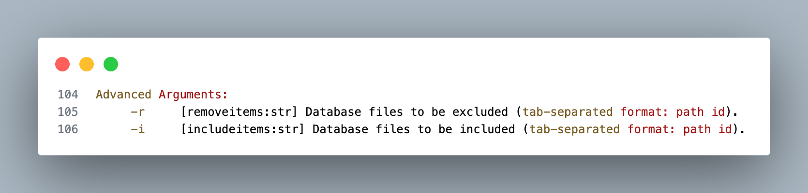

How to generate PoNs (**3 steps**):

**Step 1**:
run scMutrace on all normal samples and you will find `VCFPOS` folder in the output for each sample

**Step 2**:
run ./src/1_runStep2_generatePoN.py to extract all normal sample mutation sites

```bash
python ./src/1_runStep2_generatePoN.py --help
usage: 1_runStep2_generatePoN.py [-h] --vcfilelist VCFILELIST [--mincut MINCUT] --outdir OUTDIR

Script to obtain a list of base and cell counts in scRNA bam file

options:
  -h, --help            show this help message and exit
  --vcfilelist VCFILELIST
                        path file of VCFPOS folders in different samples [one path per line in path file]
  --mincut MINCUT       min number to get PoNs locs
  --outdir OUTDIR       output dir
```

Example_vcflist_file can be found [here](./Example_vcflist_file):

*Example Code*

```bash
# Activate conda environment if needed
conda activate scMutrace

python /path/to/1_runStep2_generatePoN.py --vcfilelist path/to/Example_vcflist_file --mincut 2 --outdir path/to/PoN_output/
```

Example *output*
```bash
qunli@login1:> head PoN.txt 
```

```bash
10	100000193	100000193
10	100000235	100000235
10	100000456	100000456
10	100000475	100000475
10	100000541	100000541
10	100000543	100000543
10	100000544	100000544
10	100000546	100000546
10	100000551	100000551
10	100000557	100000557
```

**Step 3**:
add output file path to `[removeitems:str]`
Example can be found here


run with this argument: `-r`
