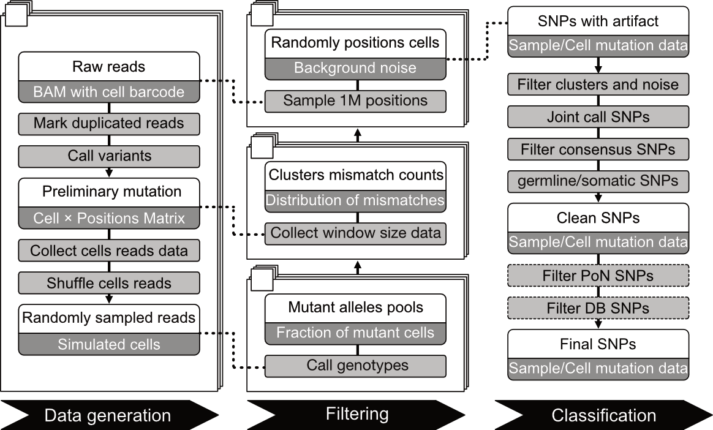

## Table of Contents
- [Dependencies](#dependencies)
    - [Requirements](#requirements)
    - [Installation](#installation)
        - [install conda env](#install-conda-env)
        - [install scMutrace](#install-scMutrace)
- [Model](#model)
- [Help information](#help-information)
- [Start](#start)
- [Parameter Index](#parameter-index)
- [Panel of Normals](#panel-of-normals)
- [Databases](#databases)
- [FAQs](#faqs)
- [Citing scMutrace](#citing-scmutrace)
- [License](#license)

## Dependencies
**scMutrace** is a single-cell mutation tracing tool designed to identify and analyze mutations from single-cell sequencing data. It offers an efficient, one-step process for background filtering, SNP extraction, noise filtering, and population structure analysis. It can be run in [Linux](https://www.linux.org/), [MacOS](https://www.apple.com/macos/) and Windows Subsystem for Linux ([WSL](https://learn.microsoft.com/en-us/windows/wsl/install)) platforms.
### Requirements
- Java 8 (https://www.java.com/en/download/manual.jsp)
    - picard.jar (https://broadinstitute.github.io/picard/)
- Python 3 (https://www.python.org/downloads/)
    - libraries
        - math (https://docs.python.org/3/library/math.html)
        - **pysam 0.21+** (https://pysam.readthedocs.io/en/latest/index.html)
        - linecache (https://docs.python.org/3/library/linecache.html)
        - subprocess (https://docs.python.org/3/library/subprocess.html)
        - collections (https://docs.python.org/3/library/collections.html)
        - numpy (https://pypi.org/project/numpy/)
        - scipy (https://pypi.org/project/scipy/)
        - random (https://docs.python.org/3/library/random.html)
        - itertools (https://docs.python.org/3/library/itertools.html)
        - statsmodels (https://pypi.org/project/statsmodels/)
        - argparse (https://pypi.org/project/argparse/)
        - timeit (https://docs.python.org/3/library/timeit.html)
        - pandas (https://pypi.org/project/pandas/)
        - multiprocessing (https://pypi.org/project/multiprocessing/)
        - re (https://docs.python.org/3/library/re.html)
- Databases (https://github.com/QunATCG/scMutrace/tree/main/resources)
- Shell (https://github.com/QunATCG/shell-scripting-tutorial)
    - `cat, mkdir, echo, head, sed, awk, grep, cd, dirname, pwd, rm, mv, while, if, uniq`

### Installation
**Anaconda** simplifies scientific computing in Python by bundling essential packages like NumPy, SciPy and Pandas. It manages dependencies and environments, making setup easier by eliminating the need to install each package individually.
> https://anaconda.org/anaconda/conda

> https://docs.anaconda.com/free/miniconda/index.html

> https://www.anaconda.com/docs/getting-started/miniconda/install#quickstart-install-instructions
#### Install conda env


If you haven't installed conda before, you can do so with the following commands:
``` shell
mkdir -p ~/miniconda3
wget https://repo.anaconda.com/miniconda/Miniconda3-latest-Linux-x86_64.sh -O ~/miniconda3/miniconda.sh
bash ~/miniconda3/miniconda.sh -b -u -p ~/miniconda3
rm -rf ~/miniconda3/miniconda.sh
```

#### Install scMutrace (option 1, recommended)
```shell
# Step 1. create env for scMutrace
conda create -n scMutrace
conda activate scMutrace

# Step 2. make sure Java is available:
# you can check java using `java -version`
# https://www.java.com/en/download/manual.jsp
# If Java is not installed, download and install it from:
# https://www.java.com/en/download/manual.jsp
# Java 8 or newer is recommended.

# Step3. install dependencies
# pysam>=0.21.0
conda install -c bioconda pysam -y
conda install -c conda-forge numpy -y
conda install -c conda-forge scipy -y
conda install -c bioconda bedtools -y
conda install -c bioconda samtools -y
conda install -c conda-forge statsmodels -y
conda install -c conda-forge biopython -y
conda install -c conda-forge scikit-allel -y
conda install -c etetoolkit ete3 -y

# Step 4. download scMutrace codes
git clone https://github.com/QunATCG/scMutrace.git
conda clean -a -y
```

#### Install scMutrace (option 2)
```shell
# Before: make sure Java is available:
# you can check java using `java -version`
# https://www.java.com/en/download/manual.jsp
# If Java is not installed, download and install it from:
# https://www.java.com/en/download/manual.jsp
# Java 8 or newer is recommended.
git clone https://github.com/QunATCG/scMutrace.git
conda clean -a -y

conda env create -f environment.yml
conda activate scMutrace
```

## Model


## Help information
You can obtain help information using the following command

`./scMutrace.sh -h`

```text
==================================================
             __  __       _
   ___  ___|  \/  |_   _| |_ _ __ __ _  ___ ___
  / __|/ __| |\/| | | | | __| '__/ _` |/ __/ _ \
  \__ \ (__| |  | | |_| | |_| | | (_| | (_|  __/
  |___/\___|_|  |_|\__,_|\__|_|  \__,_|\___\___|
==================================================
```

```shell
Description:
scMutrace is a single-cell mutation tracing tool designed to identify and analyze mutations from
single-cell sequencing data. It offers an efficient, one-step process for background filtering,
SNP extraction, noise filtering, and population structure analysis.

Usage:
./scMutrace.sh -b BAMFILE[str] -f REF[str] -c CELLBARCODE[str] -s SAMPLEID[str] -g CONTIG[str] -O OUTPUT[str]

Options:
Required Arguments:
     -b     [bam:str] Path to the BAM file to exclude background cells.
     -f     [ref:str] Path to the reference file.
     -c     [barcode:str] Cell barcode file path (tab-separated with header: Barcode CellType). If CellType is not provided, all cells will be defined as 'CellType1'.
     -s     [id:str] Sample ID.
     -O     [outdir:str] Output directory.
     -g     [contig:str] Contig information in tab-separated format: Chr	start	end.
Advanced Arguments:
     -r     [removeitems:str] Database files to be excluded (tab-separated format: path id).
     -i     [includeitems:str] Database files to be included (tab-separated format: path id).
Optional Arguments:
     -x     [barcodecheck:str] if barcode check, split bam based on cell barcodes (false or true, default: true.).]
     -u     [umi:str] umi to be used to remove duplicated reads (default: CB, if XX, no umi).
     -C     [barcodetag:str] cell barcode tag in bam file (default: CB)
     -t     [ncut:int] Number of read bases to be trimed cut (default: 10).
     -p     [nprocs:int] Number of processes to use (default: 1).
     -q     [minbq:int] Minimum base quality (default: 20).
     -Q     [minmq:int] Minimum mapping quality (default: 255). Check your mapping software quality score range (e.g STAR, BWA, HISAT2).
     -n     [mincellnumber:int] Minimum cell number (default: 3).
     -N     [minaltcellnumber:int] Minimum altered cell number (default: 2).
     -m     [maxmismatch:int] Maximum mismatch number (default: 4).
     -d     [minsequencingdepth:int] Minimum sequencing depth (default: 3).
     -D     [minaltdepth:int] Minimum alternative base depth (default: 2).
     -k     [iteration:int] Number of iterations (default: 1000).
     -e     [backp:float] Background mutant cells threshold to filter SNPs (0.03-0.08, default: 0.05).
     -E     [errorp:float] Background error threshold to filter SNPs (0.001-0.007, default: 0.006).
     -l     [binsize:int] Base number between two SNPs (default: 20).
     -L     [clustersize:int] Number of SNPs in one cluster (default: 3).
     -B     [lowBaseCutoff:int] Cutoff for low base quality (default: 20).
     -h     [help] Display this help message.
```

Cell barcode file should contain all cells that passed quality control (QC). This file can be generated using tools such as Seurat, Signac, ArchR, or other single-cell analysis pipelines.

If a cell barcode file is not provided, all cells in the BAM file will be included in the analysis. You need to extract all cell barcodes directly from the BAM file, you can use the following command (using `ENCFF491HQL.bam` as an example):

```shell
samtools view ENCFF491HQL.bam | cut -f 12- | tr "\t" "\n" | grep "^CB:Z:" | sed 's/CB:Z://' | sort | uniq > ENCFF491HQL.cellbarcode
```

## Start
[Quick Start](https://github.com/QunATCG/scMutrace-tutorial/tree/main/QuickStart)

[Step-by-Step scMutrace Tutorial](https://github.com/QunATCG/scMutrace-tutorial)

[Reproducibility Analysis](https://github.com/QunATCG/scMutrace-tutorial/tree/main/ReproducibilityAnalysis)

## Panel of Normals

scMutrace can be run without matched normal samples. If matched normal samples are available (e.g., normal tissues, other samples processed in the same way, or public datasets generated with the same sequencing protocol), scMutrace will filter out all mutations present in the Panel of Normals (PoNs).

[How to generate PoNs](https://github.com/QunATCG/scMutrace/tree/main/Example/PoNs)

## Databases
[Databases](https://github.com/QunATCG/scMutrace/tree/main/resources)

```bash
Resources
- COSMIC and 1000 Genomes–Based Mutation Annotation: https://doi.org/10.5281/zenodo.16925906

- Databases for scMutrace calling: https://doi.org/10.5281/zenodo.16962722 or https://drive.google.com/file/d/18DEmJ2CbmFV7vpADlLIxdHVpxw31DTWI/view?usp=drive_link
```

## FAQs
**If there is an issue, please report to github with logFile!**

If you have any questions or encounter problems, please open an issue here: [scMutrace Issues](https://github.com/QunATCG/scMutrace/issues)

Or contact us: qun.li@ki.se and claudia.kutter@ki.se

- Reference `test.fa`, BAM `test.bam` and Contig `test.contig` chromosome should be the same prefix format (chr or without chr).
```shell
# check BAM file chromosome format
samtools view -H test.bam | head -10
# check reference fasta chromosome format
head -10 test.fa
```

- The index file `test.bam.bai` cannot be older than the BAM file `test.bam`.
```shell
# update index file of BAM data
samtools index test.bam
```

- Base quality (BQ) and mapping quality (MQ) threshold of BAM file `test.bam` may be different. If threshold of BQ and MQ are higher than most sequenced reads, scMutrace will exclude these reads.
```shell
# default scRNA MQ is 255 and 10x scATAC MQ is 30
# default scRNA and scATAC BQ is 20; You should check BQ carefully, when you use scMutrace.
# For bowtie2, If someone wanted to exclude "true multireads" from their data set, 
# using MAPQ >= 2 would work. This would also exclude any uniquely mapping reads 
# with >=4 mismatches over high quality bases. In terms of high quality bases and unireads, 
# MAPQ >= 3 allows up to 3 mismatches, MAPQ >= 23 allows up to 2 mismatches, 
# MAPQ >= 40 allows up to 1 mismatch, and MAPQ >= 42 allows 0 mismatches. 
# There will also be other "maxireads" in most or all of these sets.
# IGV (https://igv.org/)
# Extract chromosome 1 region file (tab seperated bed file `chr1.bed`) from bam files and check BQ and MQ using IGV tool. 
samtools coverage test.bam
samtools view -hb -L chr1.bed test.bam > test1_chr.bam
samtools index test1_chr.bam
# get bam file mapping score distribution
samtools view test.bam | head -40000 | cut -f 5 | sort | uniq  -c | sort -n | awk '{printf("MAPQ:%s\t%d\n",$2,$1);}'
```

# Citing scMutrace

# License
[MIT License](./LICENSE)